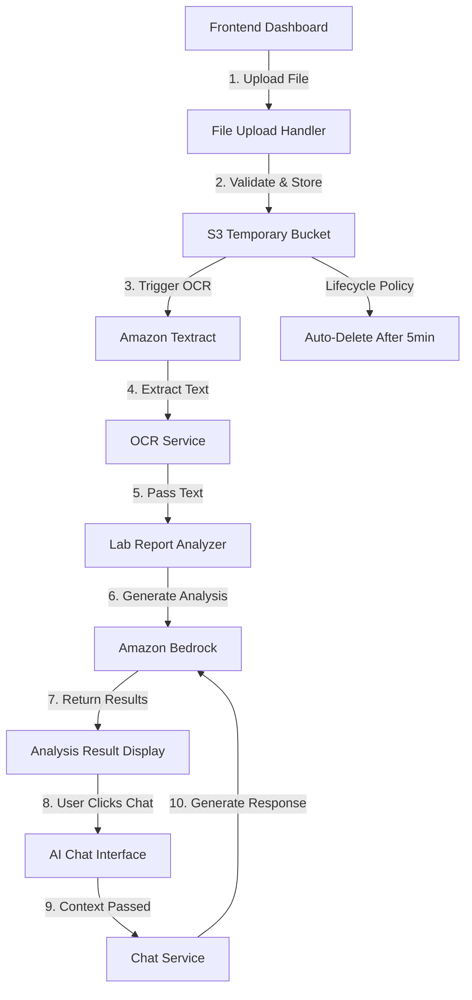

# Design Document: Lab Report Image Upload with OCR and AI Chat Integration

## Overview

This feature extends the existing lab report analyzer to accept image and PDF file uploads, extract text using OCR technology, and integrate the analysis results with the AI chat system. The design leverages AWS services (Textract for OCR, S3 for temporary storage) while maintaining the existing architecture patterns of the application.

### Key Design Goals

1. **Seamless Integration**: Extend existing lab report analyzer without breaking current text-based functionality
2. **AWS-Native OCR**: Use Amazon Textract for reliable medical document text extraction
3. **Secure File Handling**: Implement temporary file storage with automatic cleanup
4. **Chat Context Passing**: Enable users to ask follow-up questions about their analysis results
5. **Progressive Enhancement**: Maintain backward compatibility with manual text input

### Technology Choices

- **OCR Service**: Amazon Textract (DetectDocumentText API)
  - Rationale: Already using AWS ecosystem, excellent accuracy for medical documents, supports both images and PDFs
  - Alternative considered: Tesseract.js (rejected due to lower accuracy and client-side processing limitations)

- **File Storage**: Amazon S3 with lifecycle policies
  - Rationale: Temporary storage with automatic deletion, integrates with Textract, secure presigned URLs
  - Alternative considered: Local filesystem (rejected due to App Runner ephemeral storage)

- **File Upload**: Multipart form data with client-side validation
  - Rationale: Standard approach, supports large files, progress tracking capability
  - Alternative considered: Base64 encoding (rejected due to size overhead)

## Architecture

### System Components



### Data Flow

1. **Upload Phase**
   - User selects file (JPEG/PNG/HEIC/PDF)
   - Frontend validates file type and size
   - File uploaded to backend via multipart/form-data
   - Backend validates and uploads to S3 temporary bucket

2. **OCR Phase**
   - Backend invokes Textract DetectDocumentText
   - Textract processes file from S3
   - Extracted text returned to backend
   - S3 file marked for deletion (lifecycle policy)

3. **Analysis Phase**
   - Extracted text passed to existing `labReportService.parseLabReport()`
   - AI analysis generated via Bedrock (existing flow)
   - Results stored in DynamoDB LabReports table
   - Results displayed to user

4. **Chat Integration Phase**
   - User clicks "Ask Questions About This Report" button
   - Frontend navigates to AI Chat module
   - Analysis context passed via URL parameters or session storage
   - Chat service initializes with lab report context
   - User can ask follow-up questions with context awareness

### Component Interactions

**New Components**:
- `fileUploadService.js`: Handles file validation, S3 upload, and cleanup
- `ocrService.js`: Manages Textract API calls and text extraction
- Frontend file upload UI component

**Modified Components**:
- `labReportService.js`: Add entry point for file-based analysis
- `chatService.js`: Add context initialization for lab report data
- `dashboard.js`: Add file upload UI and chat integration button
- `dashboard.html`: Add file input and chat button elements

**Unchanged Components**:
- `aiEngineService.js`: No changes needed
- `authService.js`: No changes needed
- DynamoDB tables: LabReports table already exists


## Components and Interfaces

### Backend Services

#### 1. File Upload Service (`backend/services/fileUploadService.js`)

```javascript
/**
 * Validates uploaded file
 * @param {Object} file - Multer file object
 * @returns {Object} { valid: boolean, error?: string }
 */
function validateFile(file)

/**
 * Uploads file to S3 temporary bucket
 * @param {Object} file - Multer file object
 * @param {string} userId - User ID for namespacing
 * @returns {Promise<string>} S3 object key
 */
async function uploadToS3(file, userId)

/**
 * Deletes file from S3
 * @param {string} s3Key - S3 object key
 * @returns {Promise<void>}
 */
async function deleteFromS3(s3Key)
```

**Configuration**:
- Accepted MIME types: `image/jpeg`, `image/png`, `image/heic`, `application/pdf`
- Max file size: 10MB
- S3 bucket: `swasthya-sathi-temp-uploads`
- S3 key format: `lab-reports/{userId}/{timestamp}-{filename}`

#### 2. OCR Service (`backend/services/ocrService.js`)

```javascript
/**
 * Extracts text from image/PDF using Amazon Textract
 * @param {string} s3Bucket - S3 bucket name
 * @param {string} s3Key - S3 object key
 * @returns {Promise<string>} Extracted text
 */
async function extractText(s3Bucket, s3Key)

/**
 * Validates extracted text quality
 * @param {string} text - Extracted text
 * @returns {Object} { valid: boolean, warning?: string }
 */
function validateExtractedText(text)
```

**Textract Configuration**:
- API: `DetectDocumentText`
- Features: Basic text detection (no tables/forms needed for lab reports)
- Error handling: Retry logic with exponential backoff

#### 3. Lab Report Service (Modified)

```javascript
/**
 * NEW: Analyzes lab report from uploaded file
 * @param {string} userId - User ID
 * @param {Object} file - Multer file object
 * @returns {Promise<Object>} Analysis result
 */
async function analyzeFromFile(userId, file)

// Existing functions remain unchanged:
// - parseLabReport(reportText)
// - detectAbnormals(labReport)
// - generateAIExplanation(labReport, abnormals)
```

#### 4. Chat Service (Modified)

```javascript
/**
 * NEW: Submit question with lab report context
 * @param {string} userId - User ID
 * @param {string} question - User question
 * @param {Object} labReportContext - Lab report analysis data
 * @returns {Promise<Object>} Draft response
 */
async function submitQuestionWithContext(userId, question, labReportContext)

// Existing functions remain unchanged:
// - submitQuestion(userId, question)
// - getDraftResponse(draftId, userId)
// - reviewDraft(draftId, clinicianId, action, editedResponse, clinicianNotes)
```

### API Endpoints

#### New Endpoints

```
POST /api/lab-report/analyze-file
- Content-Type: multipart/form-data
- Body: { file: File }
- Headers: Authorization: Bearer <token>
- Response: Same as existing /analyze endpoint
```

```
POST /api/chat/ask-with-context
- Content-Type: application/json
- Body: { question: string, labReportContext: Object }
- Headers: Authorization: Bearer <token>
- Response: Same as existing /ask endpoint
```

### Frontend Components

#### File Upload UI

```html
<div class="file-upload-section">
  <div class="upload-tabs">
    <button class="tab-btn active" data-tab="text">Manual Entry</button>
    <button class="tab-btn" data-tab="file">Upload File</button>
  </div>
  
  <div class="tab-content" id="text-tab">
    <!-- Existing textarea -->
  </div>
  
  <div class="tab-content hidden" id="file-tab">
    <div class="file-drop-zone">
      <input type="file" id="lab-file-input" accept=".jpg,.jpeg,.png,.heic,.pdf">
      <label for="lab-file-input">
        <i class="fas fa-cloud-upload-alt"></i>
        <p>Click to upload or drag and drop</p>
        <p class="file-types">JPEG, PNG, HEIC, PDF (Max 10MB)</p>
      </label>
    </div>
    <div class="upload-progress hidden">
      <div class="progress-bar"></div>
      <p class="progress-text">Uploading...</p>
    </div>
  </div>
</div>
```

#### Chat Integration Button

```html
<div class="chat-integration-section">
  <button id="ask-about-report-btn" class="chat-integration-btn">
    <i class="fas fa-comments"></i>
    Ask Questions About This Report
  </button>
</div>
```

#### Frontend Functions

```javascript
/**
 * Handles file upload and analysis
 */
async function handleFileUpload(file)

/**
 * Validates file on client side
 */
function validateFileClient(file)

/**
 * Shows upload progress
 */
function updateUploadProgress(percent)

/**
 * Navigates to chat with lab report context
 */
function openChatWithContext(analysisResult)
```


## Data Models

### S3 Object Metadata

```javascript
{
  "Bucket": "swasthya-sathi-temp-uploads",
  "Key": "lab-reports/{userId}/{timestamp}-{filename}",
  "Metadata": {
    "userId": "string",
    "uploadedAt": "ISO8601 timestamp",
    "originalFilename": "string"
  },
  "Tagging": "AutoDelete=true"
}
```

### Textract Response (Simplified)

```javascript
{
  "DocumentMetadata": {
    "Pages": 1
  },
  "Blocks": [
    {
      "BlockType": "LINE",
      "Text": "HbA1c: 6.5%",
      "Confidence": 99.5
    }
    // ... more blocks
  ]
}
```

### Lab Report Context Object

```javascript
{
  "reportId": "string",
  "analyzedAt": "ISO8601 timestamp",
  "parsedValues": [
    {
      "name": "HbA1c",
      "value": 6.5,
      "unit": "%",
      "referenceRange": { "min": 4.0, "max": 5.6 }
    }
  ],
  "abnormals": ["HbA1c"],
  "aiExplanation": "string"
}
```

### DynamoDB LabReports Table (Modified)

```javascript
{
  "reportId": "uuid",
  "userId": "string",
  "reportText": "string", // Original or extracted text
  "sourceType": "manual" | "file", // NEW field
  "fileName": "string", // NEW field (optional)
  "parsedValues": [...],
  "abnormals": [...],
  "aiExplanation": "string",
  "analyzedAt": "ISO8601 timestamp"
}
```

### Chat Draft with Context (Modified)

```javascript
{
  "draftId": "uuid",
  "userId": "string",
  "question": "string",
  "labReportContext": { // NEW field (optional)
    "reportId": "string",
    "parsedValues": [...],
    "abnormals": [...]
  },
  "aiResponse": "string",
  "status": "pending_review" | "approved" | "rejected",
  "createdAt": "ISO8601 timestamp"
}
```


## Correctness Properties

*A property is a characteristic or behavior that should hold true across all valid executions of a system—essentially, a formal statement about what the system should do. Properties serve as the bridge between human-readable specifications and machine-verifiable correctness guarantees.*

### Property 1: Supported file formats are accepted

*For any* file with MIME type of `image/jpeg`, `image/png`, `image/heic`, or `application/pdf`, the file validation function should return `valid: true`.

**Validates: Requirements 1.1, 1.2, 1.3, 1.4**

### Property 2: Unsupported file formats are rejected

*For any* file with a MIME type that is not in the supported formats list, the file validation function should return `valid: false` with an error message indicating the accepted formats.

**Validates: Requirements 1.5**

### Property 3: Oversized files are rejected

*For any* file with size greater than 10MB (10,485,760 bytes), the file validation function should return `valid: false` with an error message indicating the maximum file size.

**Validates: Requirements 1.6**

### Property 4: Multi-page PDF text extraction

*For any* valid PDF file with N pages (where N > 1), the OCR service should extract text from all N pages, not just the first page.

**Validates: Requirements 2.2**

### Property 5: Short extracted text triggers warning

*For any* extracted text with length less than 10 characters, the OCR service should return a validation result with a warning that the file may not contain readable text.

**Validates: Requirements 2.6**

### Property 6: Extracted text follows same analysis path

*For any* extracted text from a file upload, the lab report analyzer should process it using the same `parseLabReport()` function as manual text input, producing an analysis result with the same structure (parsedValues, abnormals, aiExplanation).

**Validates: Requirements 3.1, 3.2**

### Property 7: Invalid lab data is detected

*For any* extracted text that does not match lab report patterns (no test names like HbA1c, LDL, etc.), the analyzer should return an appropriate message indicating no lab data was detected.

**Validates: Requirements 3.5**

### Property 8: Chat context is passed and utilized

*For any* analysis result, when transitioning to the AI chat interface, the lab report context (reportId, parsedValues, abnormals) should be passed to the chat service and included in the AI prompt for context-aware responses.

**Validates: Requirements 4.4, 4.5**

### Property 9: Chat session maintains conversation history

*For any* chat session with lab report context, submitting multiple questions should maintain the conversation history, with each subsequent question having access to both the lab report context and previous Q&A pairs.

**Validates: Requirements 4.7**

### Property 10: Processing errors return specific messages

*For any* processing stage (upload, OCR, analysis) that encounters an error, the system should return a specific error message that identifies which stage failed and suggests appropriate next steps (retry, use manual input, etc.).

**Validates: Requirements 5.5**

### Property 11: Temporary files are deleted after processing

*For any* file uploaded to S3 temporary storage, after OCR processing completes (successfully or with error), the file should be deleted from S3 within the configured cleanup window.

**Validates: Requirements 6.2, 6.3**

### Property 12: Session cleanup removes file data

*For any* user session that ends (logout or timeout), all uploaded file data and analysis results should be cleared from server memory and temporary storage.

**Validates: Requirements 6.5**

### Property 13: Manual text input remains functional

*For any* text input provided through the manual entry method, the lab report analyzer should produce the same analysis results as it did before the file upload feature was added, demonstrating backward compatibility.

**Validates: Requirements 7.1, 7.3**

### Property 14: Input method switching preserves session

*For any* user session, switching between file upload mode and manual text entry mode should not clear the user's authentication token or session data.

**Validates: Requirements 7.4**


## Error Handling

### File Upload Errors

1. **Invalid File Type**
   - Error Code: `INVALID_FILE_TYPE`
   - Message: "File type not supported. Please upload JPEG, PNG, HEIC, or PDF files."
   - HTTP Status: 400
   - User Action: Select a different file

2. **File Too Large**
   - Error Code: `FILE_TOO_LARGE`
   - Message: "File size exceeds 10MB limit. Please upload a smaller file or use manual text entry."
   - HTTP Status: 413
   - User Action: Compress file or use manual entry

3. **Upload Failed**
   - Error Code: `UPLOAD_FAILED`
   - Message: "Failed to upload file. Please check your connection and try again."
   - HTTP Status: 500
   - User Action: Retry upload

### OCR Errors

1. **Textract API Error**
   - Error Code: `OCR_SERVICE_ERROR`
   - Message: "Text extraction service is temporarily unavailable. Please try again or use manual text entry."
   - HTTP Status: 503
   - User Action: Retry or use manual entry
   - Logging: Log full Textract error for debugging

2. **No Text Detected**
   - Error Code: `NO_TEXT_DETECTED`
   - Message: "No readable text found in the file. Please ensure the image is clear or try manual text entry."
   - HTTP Status: 422
   - User Action: Upload different file or use manual entry

3. **Low Quality Text**
   - Error Code: `LOW_QUALITY_TEXT`
   - Message: "Warning: Very little text was extracted. Results may be incomplete. Consider using manual text entry for better accuracy."
   - HTTP Status: 200 (warning, not error)
   - User Action: Review results or re-upload

### Analysis Errors

1. **No Lab Data Found**
   - Error Code: `NO_LAB_DATA`
   - Message: "No recognizable lab report data found in the extracted text. Please ensure the file contains lab test results."
   - HTTP Status: 422
   - User Action: Upload correct file or use manual entry

2. **Bedrock API Error**
   - Error Code: `AI_SERVICE_ERROR`
   - Message: "AI analysis service is temporarily unavailable. Your lab data was saved and you can view it later."
   - HTTP Status: 503
   - User Action: Wait and retry
   - Fallback: Save parsed values without AI explanation

### S3 Errors

1. **S3 Upload Failed**
   - Error Code: `STORAGE_ERROR`
   - Message: "Failed to store file temporarily. Please try again."
   - HTTP Status: 500
   - User Action: Retry upload
   - Logging: Log S3 error details

2. **S3 Deletion Failed**
   - Error Code: `CLEANUP_ERROR`
   - Message: Internal error (not shown to user)
   - HTTP Status: N/A
   - User Action: None (background process)
   - Logging: Log error, rely on lifecycle policy as backup

### Chat Integration Errors

1. **Missing Context**
   - Error Code: `MISSING_CONTEXT`
   - Message: "Lab report context not found. Please analyze a lab report first."
   - HTTP Status: 400
   - User Action: Return to lab analyzer

2. **Context Expired**
   - Error Code: `CONTEXT_EXPIRED`
   - Message: "Lab report session expired. Please analyze your report again."
   - HTTP Status: 410
   - User Action: Re-analyze report

### Error Recovery Strategies

1. **Retry with Exponential Backoff**
   - Applied to: Textract API calls, Bedrock API calls
   - Max retries: 3
   - Backoff: 1s, 2s, 4s

2. **Graceful Degradation**
   - If Bedrock fails: Save parsed values without AI explanation
   - If Textract fails: Offer manual text entry
   - If S3 cleanup fails: Rely on lifecycle policy

3. **User Guidance**
   - All errors include specific next steps
   - Provide alternative input methods
   - Clear distinction between temporary and permanent failures


## Testing Strategy

### Dual Testing Approach

This feature will be validated using both unit tests and property-based tests, as they serve complementary purposes:

- **Unit Tests**: Verify specific examples, edge cases, and integration points
- **Property-Based Tests**: Verify universal properties across randomized inputs

### Property-Based Testing

**Library**: `fast-check` (JavaScript property-based testing library)

**Configuration**:
- Minimum 100 iterations per property test
- Each test tagged with: `Feature: lab-report-image-upload-with-chat-integration, Property {number}: {property_text}`

**Property Test Coverage**:

1. **File Validation Properties** (Properties 1-3)
   - Generate random files with various MIME types
   - Generate random file sizes
   - Verify validation logic for all combinations

2. **OCR Properties** (Properties 4-5)
   - Generate multi-page PDFs with known page counts
   - Generate text of various lengths
   - Verify extraction and validation behavior

3. **Analysis Path Properties** (Properties 6-7)
   - Generate random lab report text
   - Generate random non-lab text
   - Verify consistent processing and error detection

4. **Chat Integration Properties** (Properties 8-9)
   - Generate random analysis results
   - Generate random question sequences
   - Verify context passing and history maintenance

5. **Error Handling Properties** (Property 10)
   - Simulate failures at each stage
   - Verify error message specificity

6. **Cleanup Properties** (Properties 11-12)
   - Generate random file uploads
   - Verify deletion after processing
   - Verify session cleanup

7. **Backward Compatibility Properties** (Properties 13-14)
   - Generate random manual text inputs
   - Verify unchanged behavior
   - Verify session persistence during mode switching

### Unit Testing

**Focus Areas**:

1. **File Upload Service**
   - Test specific MIME type validation
   - Test exact 10MB boundary
   - Test S3 upload with mocked AWS SDK
   - Test S3 deletion with mocked AWS SDK

2. **OCR Service**
   - Test Textract API integration with mocked responses
   - Test text extraction from sample images
   - Test error handling for Textract failures
   - Test text quality validation edge cases

3. **Lab Report Service Integration**
   - Test file-based analysis flow
   - Test that existing manual text flow is unchanged
   - Test error propagation from OCR to analysis

4. **Chat Service Integration**
   - Test context initialization with sample lab data
   - Test question submission with context
   - Test context persistence across multiple questions

5. **API Endpoints**
   - Test `/api/lab-report/analyze-file` with sample files
   - Test `/api/chat/ask-with-context` with sample context
   - Test authentication and authorization
   - Test error responses

6. **Frontend Components**
   - Test file selection and validation
   - Test upload progress display
   - Test chat button click and navigation
   - Test tab switching between manual and file upload

### Integration Testing

1. **End-to-End File Upload Flow**
   - Upload sample lab report image
   - Verify OCR extraction
   - Verify analysis generation
   - Verify result display

2. **End-to-End Chat Integration Flow**
   - Analyze lab report
   - Click chat integration button
   - Submit question with context
   - Verify context-aware response

3. **Cleanup Verification**
   - Upload file
   - Complete processing
   - Verify S3 file deletion
   - Verify session cleanup on logout

### Manual Testing Checklist

1. **File Upload UI**
   - [ ] File selection dialog opens
   - [ ] Drag-and-drop works
   - [ ] Progress bar displays during upload
   - [ ] Error messages display correctly

2. **OCR Processing**
   - [ ] Loading indicator shows during OCR
   - [ ] Results display after extraction
   - [ ] Warnings show for low-quality text

3. **Chat Integration**
   - [ ] Button appears after analysis
   - [ ] Navigation to chat works
   - [ ] Context is available in chat
   - [ ] Follow-up questions work

4. **Error Scenarios**
   - [ ] Invalid file type shows error
   - [ ] Oversized file shows error
   - [ ] OCR failure shows error with guidance
   - [ ] Network errors handled gracefully

5. **Backward Compatibility**
   - [ ] Manual text entry still works
   - [ ] Tab switching works
   - [ ] Existing features unaffected

### Performance Testing

1. **File Upload Performance**
   - Target: < 5 seconds for 5MB file upload
   - Measure: Time from file selection to S3 upload complete

2. **OCR Performance**
   - Target: < 10 seconds for single-page image
   - Target: < 20 seconds for 5-page PDF
   - Measure: Time from Textract invocation to text extraction complete

3. **End-to-End Performance**
   - Target: < 30 seconds from upload to analysis display (per requirement 5.6)
   - Measure: Total time for complete flow

### Security Testing

1. **File Validation**
   - Test file type spoofing (wrong extension with different MIME type)
   - Test malicious file uploads
   - Test path traversal attempts in filenames

2. **S3 Security**
   - Verify presigned URL expiration
   - Verify bucket permissions (no public access)
   - Verify file isolation between users

3. **Data Privacy**
   - Verify files are deleted after processing
   - Verify no data leakage between users
   - Verify HTTPS enforcement
