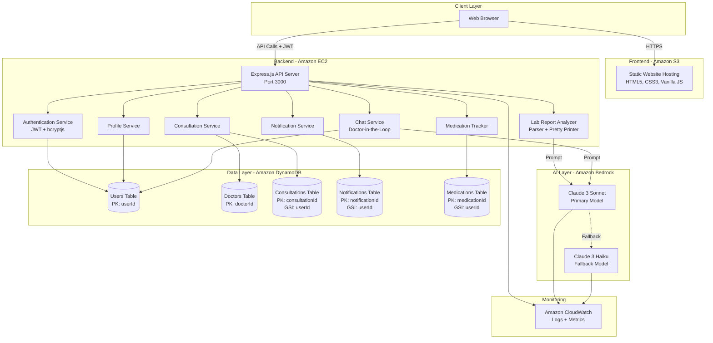

# Design Document: Swasthya Sathi Healthcare Platform

## Overview

Swasthya Sathi is a cloud-native healthcare support platform that combines AI-powered medical information assistance with strict clinical oversight. The system architecture prioritizes patient safety through a Doctor-in-the-Loop pattern, where all AI-generated health advice undergoes clinician review before delivery.

The platform consists of six core modules:
1. **Lab Report Analyzer**: Parses medical lab reports and generates patient-friendly explanations
2. **AI Chat with Doctor-in-the-Loop**: Enables safe health Q&A with mandatory clinician approval
3. **Medication Tracker**: Manages medication schedules and generates reminders
4. **Consultation Scheduling**: Facilitates appointment booking with verified doctors
5. **Notification System**: Delivers timely alerts for medications and appointments
6. **Profile Management**: Handles user account information and authentication

The architecture follows a stateless backend design using JWT authentication, with all data persisted in DynamoDB. Amazon Bedrock provides AI capabilities with automatic fallback from Claude 3 Sonnet to Claude 3 Haiku for resilience.

### Key Design Principles

- **Safety First**: AI guardrails enforced at prompt level, Doctor-in-the-Loop for all health advice
- **Stateless Architecture**: No session data on EC2, all state in DynamoDB or JWT tokens
- **Resilient AI**: Automatic fallback between Bedrock models
- **Scalable Data Access**: DynamoDB with GSIs for efficient multi-access patterns
- **Security by Default**: JWT authentication, IAM roles, encrypted communications

## Architecture

### System Architecture Diagram



### Component Interaction Flow

#### Lab Report Analysis Flow
1. Patient submits lab report text via frontend
2. API validates JWT token
3. Lab Analyzer parses text into structured LabReport object
4. Lab Analyzer identifies abnormal values outside reference ranges
5. Lab Analyzer constructs prompt with guardrails and sends to Bedrock (Sonnet primary)
6. AI generates patient-friendly explanation
7. Lab Analyzer appends safety disclaimer
8. Response returned to frontend within 5 seconds

#### AI Chat with Doctor-in-the-Loop Flow
1. Patient submits health question via frontend
2. API validates JWT token
3. Chat Service constructs prompt with guardrails and sends to Bedrock
4. AI generates draft response within 5 seconds
5. Chat Service stores draft in DynamoDB with status "pending_review"
6. Notification sent to available clinician
7. Clinician reviews draft and approves/rejects
8. If approved: status updated to "approved", response delivered to patient
9. If rejected: status updated to "rejected", new draft requested

#### Medication Reminder Flow
1. Patient adds medication via frontend
2. API validates JWT token and stores medication in DynamoDB
3. Background scheduler checks for due medications every minute
4. When medication time arrives, Notification Service creates reminder
5. Notification stored in DynamoDB with type "medication_reminder"
6. Frontend polls for new notifications and displays badge count

### Deployment Architecture

- **Frontend**: Amazon S3 bucket configured for static website hosting, public read access, HTTPS enabled
- **Backend**: Node.js Express server on Amazon EC2, security groups allow ports 80/443, CloudWatch logging enabled
- **Database**: DynamoDB tables with on-demand billing, GSIs for userId queries
- **AI**: Amazon Bedrock with IAM role-based access, automatic model fallback
- **Monitoring**: CloudWatch logs for API requests, errors, AI interactions, token usage

## Components and Interfaces

### Authentication Service

**Responsibilities**: User registration, login, JWT token generation and validation

**Interface**:
```javascript
// POST /api/auth/register
Request: { name, email, password, age, gender, phone }
Response: { userId, message: "Registration successful" }

// POST /api/auth/login
Request: { email, password }
Response: { token, userId, expiresIn: "24h" }

// Middleware: validateJWT
Validates JWT token from Authorization header
Throws 401 if invalid/expired
```

**Implementation Details**:
- Uses bcryptjs with salt factor 10 for password hashing
- JWT tokens valid for 24 hours
- Stateless validation (no session storage)
- Returns authentication errors within 200ms

### Lab Report Analyzer

**Responsibilities**: Parse lab reports, identify abnormal values, generate AI explanations

**Interface**:
```javascript
// POST /api/lab-report/analyze
Request: { reportText: string }
Response: { 
  parsedValues: LabReport,
  abnormalResults: string[],
  explanation: string,
  disclaimer: string
}

// Internal: parseLabReport(text: string): LabReport
// Internal: prettyPrintLabReport(report: LabReport): string
// Internal: identifyAbnormals(report: LabReport): string[]
```

**Data Structure**:
```javascript
LabReport {
  tests: [
    {
      name: string,        // e.g., "HbA1c"
      value: number,       // e.g., 6.5
      unit: string,        // e.g., "%"
      referenceRange: {    // e.g., { min: 4.0, max: 5.6 }
        min: number,
        max: number
      }
    }
  ]
}
```

**Implementation Details**:
- Parser supports: HbA1c, LDL, HDL, WBC, RBC, Hemoglobin
- Abnormal detection: value < min OR value > max
- AI prompt includes structured data + guardrails
- Guardrails: "Do not provide diagnosis, prescriptions, or medication stopping advice"
- Safety disclaimer appended to all responses
- Round-trip property: parse(prettyPrint(parse(text))) ≡ parse(text)

### Chat Service

**Responsibilities**: Handle patient questions, manage Doctor-in-the-Loop workflow

**Interface**:
```javascript
// POST /api/chat/ask
Request: { question: string, userId: string }
Response: { draftId: string, status: "pending_review" }

// GET /api/chat/response/:draftId
Response: { 
  status: "pending_review" | "approved" | "rejected",
  response?: string,
  disclaimer?: string
}

// POST /api/chat/review (Clinician only)
Request: { draftId: string, action: "approve" | "reject" }
Response: { status: string }
```

**DynamoDB Schema**:
```javascript
ChatDrafts {
  draftId: string (PK),
  userId: string,
  question: string,
  aiResponse: string,
  status: "pending_review" | "approved" | "rejected",
  reviewedBy?: string,
  createdAt: timestamp,
  reviewedAt?: timestamp
}
```

**Implementation Details**:
- AI draft generation within 5 seconds
- Guardrails: "Do not diagnose, prescribe, or provide emergency medical advice"
- No response delivered without clinician approval
- Clinician notification within 10 seconds of draft creation
- Rejected drafts trigger new AI generation

### Medication Tracker

**Responsibilities**: Store medications, generate reminders, manage schedules

**Interface**:
```javascript
// POST /api/medications
Request: { 
  name: string,
  dosage: string,
  frequency: "once_daily" | "twice_daily" | "thrice_daily" | "custom",
  customInterval?: number, // minutes
  notes?: string
}
Response: { medicationId: string }

// GET /api/medications
Response: { medications: Medication[] }

// DELETE /api/medications/:medicationId
Response: { message: "Medication deleted" }
```

**DynamoDB Schema**:
```javascript
Medications {
  medicationId: string (PK),
  userId: string (GSI),
  name: string,
  dosage: string,
  frequency: string,
  customInterval?: number,
  notes?: string,
  nextReminderAt: timestamp,
  createdAt: timestamp
}
```

**Implementation Details**:
- Background scheduler runs every minute
- Reminders generated within 60 seconds of scheduled time
- Frequency mapping: once_daily=24h, twice_daily=12h, thrice_daily=8h
- Deletion cancels future reminders within 1 second
- Query by userId using GSI, returns within 500ms

### Consultation Service

**Responsibilities**: Manage doctor profiles, schedule consultations, calculate pricing

**Interface**:
```javascript
// GET /api/doctors
Response: { 
  doctors: [
    {
      doctorId: string,
      name: string,
      specialization: string,
      experienceYears: number,
      rating: number,
      baseRate: number
    }
  ]
}

// GET /api/doctors/:doctorId
Response: { 
  doctor: Doctor,
  calculatedPrice: number // baseRate + (experienceYears * 50)
}

// POST /api/consultations
Request: { doctorId: string, userId: string }
Response: { 
  consultationId: string,
  scheduledFor: timestamp, // next day 10:00 AM
  status: "scheduled"
}
```

**DynamoDB Schemas**:
```javascript
Doctors {
  doctorId: string (PK),
  name: string,
  specialization: string,
  experienceYears: number,
  rating: number,
  baseRate: number,
  verified: boolean
}

Consultations {
  consultationId: string (PK),
  userId: string (GSI),
  doctorId: string,
  scheduledFor: timestamp,
  status: "scheduled" | "completed" | "cancelled",
  createdAt: timestamp
}
```

**Implementation Details**:
- Pricing formula: baseRate + (experienceYears × 50)
- Default scheduling: next day at 10:00 AM
- Creates meeting reminder notifications for both patient and doctor
- Initial status always "scheduled"

### Notification Service

**Responsibilities**: Create, store, retrieve, and mark notifications as read

**Interface**:
```javascript
// GET /api/notifications
Response: { 
  notifications: Notification[],
  unreadCount: number
}

// PUT /api/notifications/:notificationId/read
Response: { message: "Notification marked as read" }

// Internal: createNotification(userId, type, message)
```

**DynamoDB Schema**:
```javascript
Notifications {
  notificationId: string (PK),
  userId: string (GSI),
  type: "medication_reminder" | "meeting_reminder" | "system_update",
  message: string,
  isRead: boolean,
  createdAt: timestamp
}
```

**Implementation Details**:
- Supports three notification types
- Unread badge count calculated from isRead=false
- Mark as read within 200ms
- Query by userId using GSI, sorted by createdAt descending

### Profile Service

**Responsibilities**: Retrieve and update user profile information

**Interface**:
```javascript
// GET /api/profile
Response: { 
  userId: string,
  name: string,
  email: string,
  age: number,
  gender: string,
  phone: string
}

// PUT /api/profile
Request: { name?, email?, age?, gender?, phone?, password? }
Response: { message: "Profile updated successfully" }
```

**Implementation Details**:
- All operations require JWT authentication
- Profile retrieval within 300ms
- Profile updates within 500ms
- Password changes use bcryptjs hashing
- Email uniqueness validation before update

### AI Engine Integration

**Responsibilities**: Manage Bedrock API calls, handle fallback, log metrics

**Interface**:
```javascript
// Internal: generateAIResponse(prompt: string, guardrails: string[]): Promise<AIResponse>

AIResponse {
  text: string,
  model: "claude-3-sonnet" | "claude-3-haiku",
  tokenCount: number,
  latency: number
}
```

**Implementation Details**:
- Primary model: Claude 4.6 Sonnet (us.anthropic.claude-4-6-sonnet-20250514-v1:0) - Current flagship
- Fallback model: Claude 3.5 Haiku (anthropic.claude-3-5-haiku-20241022-v1:0)
- Automatic fallback within 2 seconds on Sonnet failure
- Maximum response time: 5 seconds (timeout error)
- CloudWatch logging: model used, token count, latency
- IAM role-based authentication to Bedrock

## Data Models

### DynamoDB Table Designs

#### Users Table
```
Partition Key: userId (string)
Attributes:
  - name (string)
  - email (string)
  - passwordHash (string)
  - age (number)
  - gender (string)
  - phone (string)
  - role (string) // "patient" | "clinician"
  - createdAt (timestamp)
```

#### Doctors Table
```
Partition Key: doctorId (string)
Attributes:
  - name (string)
  - specialization (string)
  - experienceYears (number)
  - rating (number)
  - baseRate (number)
  - verified (boolean)
  - createdAt (timestamp)
```

#### Consultations Table
```
Partition Key: consultationId (string)
GSI: userId-index (userId as partition key)
Attributes:
  - userId (string)
  - doctorId (string)
  - scheduledFor (timestamp)
  - status (string) // "scheduled" | "completed" | "cancelled"
  - createdAt (timestamp)
```

#### Notifications Table
```
Partition Key: notificationId (string)
GSI: userId-index (userId as partition key)
Attributes:
  - userId (string)
  - type (string) // "medication_reminder" | "meeting_reminder" | "system_update"
  - message (string)
  - isRead (boolean)
  - createdAt (timestamp)
```

#### Medications Table
```
Partition Key: medicationId (string)
GSI: userId-index (userId as partition key)
Attributes:
  - userId (string)
  - name (string)
  - dosage (string)
  - frequency (string)
  - customInterval (number, optional)
  - notes (string, optional)
  - nextReminderAt (timestamp)
  - createdAt (timestamp)
```

### Access Patterns

1. **Get user by userId**: Direct query on Users table (PK)
2. **Get doctor by doctorId**: Direct query on Doctors table (PK)
3. **Get all doctors**: Scan Doctors table (small dataset, verified only)
4. **Get consultations for user**: Query Consultations GSI by userId
5. **Get notifications for user**: Query Notifications GSI by userId, sort by createdAt DESC
6. **Get medications for user**: Query Medications GSI by userId
7. **Get unread notifications count**: Query Notifications GSI by userId, filter isRead=false
8. **Update notification read status**: Update item by notificationId (PK)

### Data Validation Rules

- **Email**: Must be unique across Users table, valid email format
- **Password**: Minimum 8 characters, hashed with bcrypt salt factor 10
- **Age**: Integer between 1 and 120
- **Phone**: 10-digit numeric string
- **Medication frequency**: Must be one of: once_daily, twice_daily, thrice_daily, custom
- **Consultation status**: Must be one of: scheduled, completed, cancelled
- **Notification type**: Must be one of: medication_reminder, meeting_reminder, system_update
- **Lab report values**: Must be numeric with valid units
- **JWT token**: Must be valid and not expired (24-hour lifetime)

